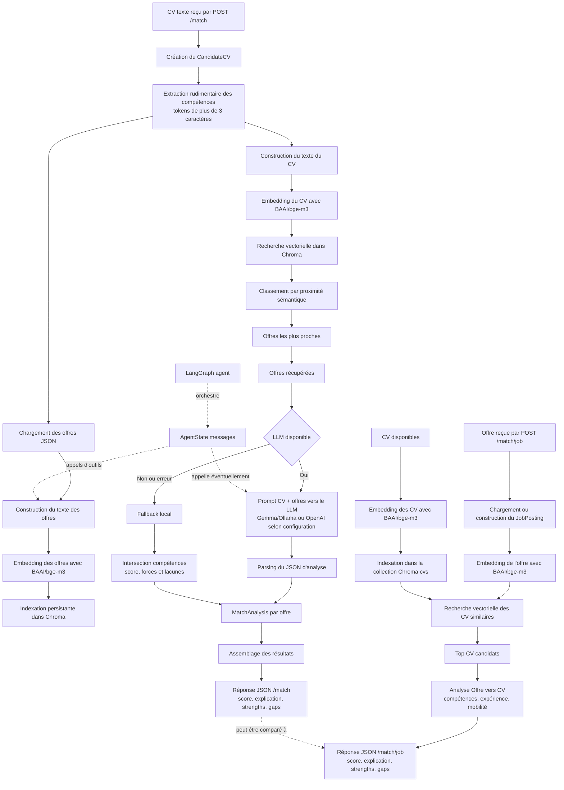

# Flux complet du matching

## Légende

    - Le chemin principal de `/match` utilise BAAI/bge-m3 pour encoder le CV et les offres.
    - Les offres sont indexées dans Chroma avant chaque recherche et persistées dans `chroma_db`.
    - La récupération ne possède plus de fallback lexical : elle dépend de la recherche vectorielle Chroma.
    - Le chemin inverse `/match/job` indexe les CV dans une collection Chroma distincte et récupère les profils les plus proches.
    - Les deux directions utilisent le même modèle BAAI/bge-m3, puis une analyse explique les forces et les écarts.

- L'analyse finale utilise le LLM configuré, avec un fallback local basé sur les compétences explicites.
